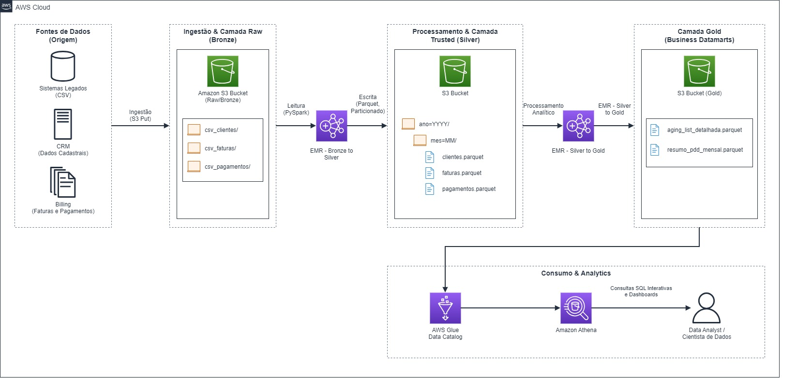

# Gestão de Inadimplência em Telecom: Como Automatizei o Cálculo de PDD na AWS

Compartilho o resultado da primeira fase de um projeto prático focado em resolver um desafio crítico no setor de Telecomunicações: o cálculo automatizado e a mensuração da **Provisão para Devedores Duvidosos (PDD)**.

### O que é PDD e qual seu impacto em Telecom?

A **PDD** é uma reserva contábil obrigatória que previne perdas financeiras decorrentes da inadimplência de clientes. Em Telecom, empresa com milhões de assinaturas recorrentes e alto volume transacional diário, gerenciar o risco de crédito exige um controle preciso da **Aging List** (faixas de atraso dos títulos em aberto). Sem dados limpos e pipelines performáticos, o risco de distorção na DRE contábil é elevado.

### Arquitetura da Solução na AWS

Para processar esses volumes de forma escalável, adotei a **Arquitetura Medallion (Bronze, Silver e Gold)** com serviços gerenciados da AWS:



* **Ingestão & Camada Bronze (Raw):** Armazenamento em arquivos CSV brutos no **Amazon S3**.

* **Camada Silver (Trusted):** Leitura, limpeza de schema, validação e tipagem forte (`to_date`, `decimal`, etc.) via **PySpark** no **Amazon EMR**, persistidos em formato **Apache Parquet** particionado por `ano` e `mes`.

* **Camada Gold (Business):** Processamento analítico em **Spark SQL** executando cruzamentos (`LEFT JOIN`) entre faturas e pagamentos para classificar o atraso em faixas de risco (1-30, 31-60, 61-90 e 90+ dias) e aplicar as taxas de provisão gerenciais.

* **Governança & Consumo:** Catálogo unificado com **AWS Glue Data Catalog** e consultas interativas via **Amazon Athena**. (próximos passos)

### Engenharia da Camada Gold: As Queries Spark SQL

Para transformar os dados brutos e limpos em inteligência financeira, desenvolvi duas consultas principais na camada Gold:

#### 1. Criação da `aging_list_detalhada`
Cruzamos as faturas ativas com os pagamentos via `LEFT JOIN` e calculamos os dias de atraso a partir de uma data de referência (`data_proc`), aplicando a tipificação das faixas de risco:

```sql
WITH faturas_em_aberto AS (
    SELECT 
        f.fatura_id, f.cliente_id, f.valor as valor_fatura, f.data_vencimento,
        c.plano, to_date('2026-03-31') as data_proc
    FROM silver_faturas f
    JOIN silver_clientes c ON f.cliente_id = c.cliente_id
    LEFT JOIN silver_pagamentos p ON f.fatura_id = p.fatura_id
    WHERE p.fatura_id IS NULL AND f.data_vencimento < to_date('2026-03-31')
),
aging_calculado AS (
    SELECT 
        fatura_id, cliente_id, plano, valor_fatura, data_vencimento, data_proc,
        DATEDIFF(data_proc, data_vencimento) as dias_atraso,
        CASE WHEN DATEDIFF(data_proc, data_vencimento) <= 30 THEN 1 ELSE 0 END as flg_1_30,
        CASE WHEN DATEDIFF(data_proc, data_vencimento) > 30 AND DATEDIFF(data_proc, data_vencimento) <= 60 THEN 1 ELSE 0 END as flg_31_60,
        CASE WHEN DATEDIFF(data_proc, data_vencimento) > 60 AND DATEDIFF(data_proc, data_vencimento) <= 90 THEN 1 ELSE 0 END as flg_61_90,
        CASE WHEN DATEDIFF(data_proc, data_vencimento) > 90 THEN 1 ELSE 0 END as flg_90_mais
    FROM faturas_em_aberto
)
SELECT * FROM aging_calculado;
```

#### 2. Criação do `resumo_pdd_mensal`
Agregamos o montante em aberto por faixa de atraso aplicando as taxas gerenciais de provisão da operadora:

```sql
WITH consolidado AS (
    SELECT '1 a 30 dias' as faixa_atraso, SUM(valor_fatura) as valor_aberto, COUNT(fatura_id) as qtd_faturas, 0.02 as taxa_provisao FROM tb_gold_aging WHERE flg_1_30 = 1
    UNION ALL
    SELECT '31 a 60 dias', SUM(valor_fatura), COUNT(fatura_id), 0.10 FROM tb_gold_aging WHERE flg_31_60 = 1
    UNION ALL
    SELECT '61 a 90 dias', SUM(valor_fatura), COUNT(fatura_id), 0.50 FROM tb_gold_aging WHERE flg_61_90 = 1
    UNION ALL
    SELECT 'Mais de 90 dias', SUM(valor_fatura), COUNT(fatura_id), 1.00 FROM tb_gold_aging WHERE flg_90_mais = 1
)
SELECT faixa_atraso, qtd_faturas, valor_aberto, CONCAT(CAST(taxa_provisao*100 AS INT), '%') as taxa_provisao, ROUND(valor_aberto * taxa_provisao, 2) as provisao_necessaria FROM consolidado;
```

---

### Resultados Obtidos na AWS

A execução bem-sucedida do pipeline no **Amazon EMR** gerou os seguintes resultados em produção:

**Amostra da `aging_list_detalhada` (Faturas críticas em atraso):**
```text
+----------+----------+-----------+------------+---------------+----------+-----------+--------+---------+---------+-----------+
| fatura_id|cliente_id|      plano|valor_fatura|data_vencimento| data_proc|dias_atraso|flg_1_30|flg_31_60|flg_61_90|flg_90_mais|
+----------+----------+-----------+------------+---------------+----------+-----------+--------+---------+---------+-----------+
|FAT_000229| CLI_00482|Fibra 500MB|      129.90|     2024-02-13|2026-03-31|        777|       0|        0|        0|          1|
|FAT_000315| CLI_00245|Fibra 300MB|       99.90|     2024-02-07|2026-03-31|        783|       0|        0|        0|          1|
|FAT_000420| CLI_00594|Fibra 300MB|       99.90|     2024-02-24|2026-03-31|        766|       0|        0|        0|          1|
|FAT_000848| CLI_00125|Fibra 300MB|       99.90|     2024-02-01|2026-03-31|        789|       0|        0|        0|          1|
|FAT_000910| CLI_00842|Fibra 500MB|      129.90|     2024-02-21|2026-03-31|        769|       0|        0|        0|          1|
+----------+----------+-----------+------------+---------------+----------+-----------+--------+---------+---------+-----------+
```

**Resumo Executivo do PDD (Visão Contábil Consolidada):**
```text
+----------------+-----------+------------------+---------------+---------------------+
|   faixa_atraso |qtd_faturas|      valor_aberto|  taxa_provisao|  provisao_necessaria|
+----------------+-----------+------------------+---------------+---------------------+
|    1 a 30 dias |          1|            129.90|             2%|                 2.60|
|   31 a 60 dias |          3|            289.70|            10%|                28.97|
|   61 a 90 dias |         22|          2,067.80|            50%|             1,033.90|
|Mais de 90 dias |       1476|        151,052.40|           100%|           151,052.40|
+----------------+-----------+------------------+---------------+---------------------+
```

### Próximos Passos (Ciência & Análise de Dados)

Este projeto continua! Nas próximas fases pretendo evoluir a solução explorando:

* **Analytics & BI:** Criação de dashboards executivos interativos via **Amazon QuickSight** / Power BI para visualização de safra e evolução do aging.

* **Ciência de Dados & ML:** Construção de modelos preditivos para identificação precoce de clientes com propensão de inadimplência antes do vencimento da fatura.

Seguimos aprendendo e evoluindo a cada pipeline! Sugestões e feedbacks de arquitetura são sempre muito bem-vindos.


